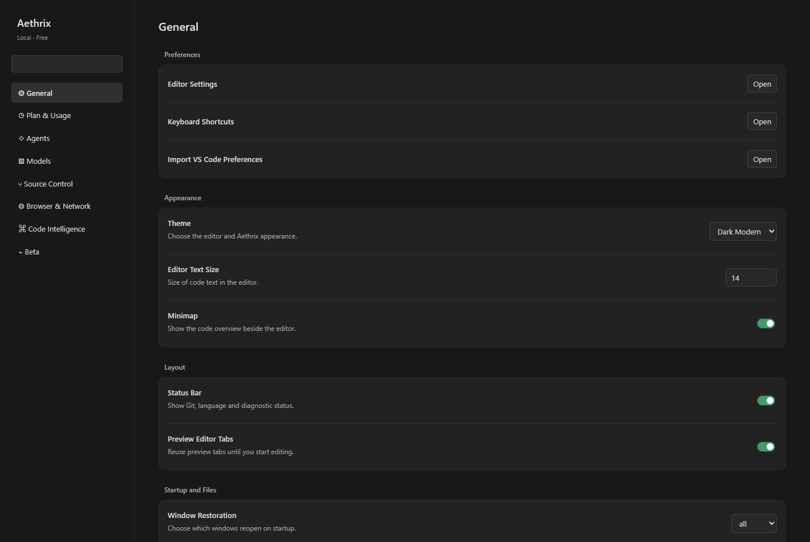

# Aethrix

A free Windows coding editor with a local Ollama assistant, built on the MIT-licensed Code - OSS workbench. Open your project, choose a local model, and chat with an assistant that can inspect code, propose edits, run approved commands, and help with C++, C#, and Windows driver development.

**[Download the Windows EXE and setup folder](https://github.com/zx7-eu/Aethrix/releases/latest)** · [Requirements](release/REQUIREMENTS.md) · [First run](release/START-HERE.md) · [User guide](USER-GUIDE.md) · [Build from source](BUILDING.md)

## New in 0.8.0

- A separate Aethrix Settings page with a top-left chat gear and persistent preferences.
- Local usage counters: requests, outcomes, reported tokens, tool calls, time, file edit operations and line additions/removals. Tracking starts with this version; historical activity is not reconstructed.
- A catalog of 44 verified local model tags, custom tags, visibility controls and live hardware/storage checks before installation.
- Working native Git integration plus staging, commits, branch creation, diffs, remote operations and read-only change review.
- One continuous response per request, collapsed tool activity and a visible red Stop control. Repository overviews stop repetitive file paging.
- Opt-in local inline suggestions, editor/language preferences and local network diagnostics.

## What makes Aethrix different

Aethrix brings local models, a full editor, and Windows development tools together in one application:

- **Your choice of local model:** no Aethrix subscription or paid API key. The model installer checks CPU, RAM, dedicated GPU memory and storage, suggests models, and warns when a selection may be too large or require slower CPU offload.
- **Workflows beyond chat:** Normal, Plan, Debug, Multi-task and Ask modes. Plan writes a Markdown plan with questions, model selection and an explicit Build action. Debug records local evidence before edits. Multi-task uses up to three isolated, read-only research workers, run sequentially.
- **A real coding workspace:** Code - OSS editor, explorer, terminal, native diffs, debugging and compatible extensions through Open VSX.
- **C++ and driver helpers:** bundled clangd, CMake Tools and CodeLLDB; detection of your compiler, SDK and WDK; build diagnostics, driver build helpers and dump-analysis integration when the necessary Microsoft tools are installed.
- **Visible control over changes:** workspace trust, approval choices, selection-only edit previews, exact-text patches, changed-file checks, per-request file undo and interrupted-request recovery.
- **Useful day-to-day chat:** saved automatically titled conversations, history search, attachments, Markdown/code rendering, context inspection and a persistent request queue.

This is a particular combination of features, not a claim that every individual feature is exclusive to Aethrix. Model quality and performance depend on the model, hardware and drivers.

## Choose your download

**Just use the app:** get `Aethrix-0.8.0-windows-x64.zip` from Releases, extract it, and read `START-HERE.md`. It contains `Aethrix.exe`, requirements, official dependency links and license notices. A separate `Aethrix.exe` asset is also available. You do not need Node.js, .NET or a source checkout to run the editor.

**Read or build the source:** browse `LocalForge-Code/` and `LocalForge-Packaging/`, or use GitHub's source download. Build prerequisites and packaging steps are in [BUILDING.md](BUILDING.md). Large generated binaries are release assets rather than Git-tracked source files.

## Requirements at a glance

The distributed build targets **Windows 10 22H2 or newer, x64**; Windows 11 is recommended. Allow at least 4 GB free for the editor download/extraction and additional space for Ollama and models. For useful local coding models, 16 GB system RAM is a practical starting point; 32 GB and a compatible dedicated GPU allow larger choices. Smaller models can run with less memory. These are practical guidelines, not benchmarked minimums.

Install [Ollama for Windows](https://ollama.com/download/windows) separately for AI. Models are separate downloads, with their own licenses, and can require many GB. Compilers, the .NET SDK, CMake/Ninja, Windows SDK/WDK and WinDbg are needed only for the development tasks that use them. See the full [requirements list](release/REQUIREMENTS.md).

## Privacy and permissions

The assistant uses a locally running Ollama server by default. Prompts, files and tool results are sent to the endpoint you configure; use a local endpoint and local model for local inference. Aethrix does not bundle your personal chats, credentials, projects, or model weights. Chats and settings are saved in your own Windows profile.

This is not an air-gapped application: downloads, model registry checks, extensions, updates and some inherited editor features can use the network. Seeded editor telemetry is off; installed extensions and external tools have their own behavior. File and command tools run with your Windows user permissions. Start with **Ask first** and review commands before enabling automatic approval. File undo does not reverse command side effects.

## Current limitations

- Windows x64 is the packaged/tested platform. The EXE is **unsigned** and may trigger Windows reputation warnings; SHA-256 checksums are included with releases.
- Hardware fit is an estimate, not a speed or driver-compatibility guarantee. CPU offload can be slow. AirLLM and “70B at normal speed on 4 GB VRAM” are not implemented or promised.
- Model responses can be wrong and tool support varies. Driver assistance does not make generated kernel code safe or correct.
- Kernel debugging requires separate WinDbg/WDK configuration. Aethrix does not load drivers or change boot/signing settings.
- Open VSX is used for extensions. Microsoft Marketplace and some proprietary extensions/services are not available in this fork.
- Aethrix is an early release; back up important projects and review generated changes.

## Source access and licensing

The public repository is read-only for visitors: only people explicitly granted write access can change this repository. No public write access is granted by publishing it. The source remains under MIT and applicable third-party licenses, which permit copying, forking and modification; “read-only” does not revoke those rights. Contributions are currently maintainer-managed; see [CONTRIBUTING.md](CONTRIBUTING.md).

Aethrix is independently branded and is not an official Microsoft Visual Studio Code distribution. The editor source derives from [microsoft/vscode](https://github.com/microsoft/vscode), commit `743b7f939f37a9c2a59f1e2177335db6e5735a1f`. Upstream MIT notices and third-party licenses are preserved. See [LICENSE.txt](LICENSE.txt), [ThirdPartyNotices.txt](ThirdPartyNotices.txt), and [NOTICE.md](NOTICE.md). Assistant version: **0.8.0**; editor base: **1.143.0**.

## Aethrix Settings

